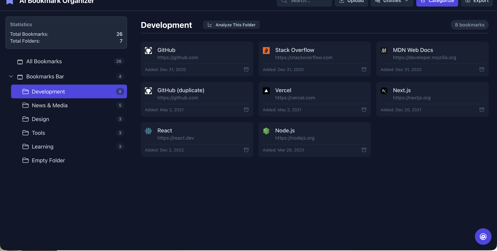
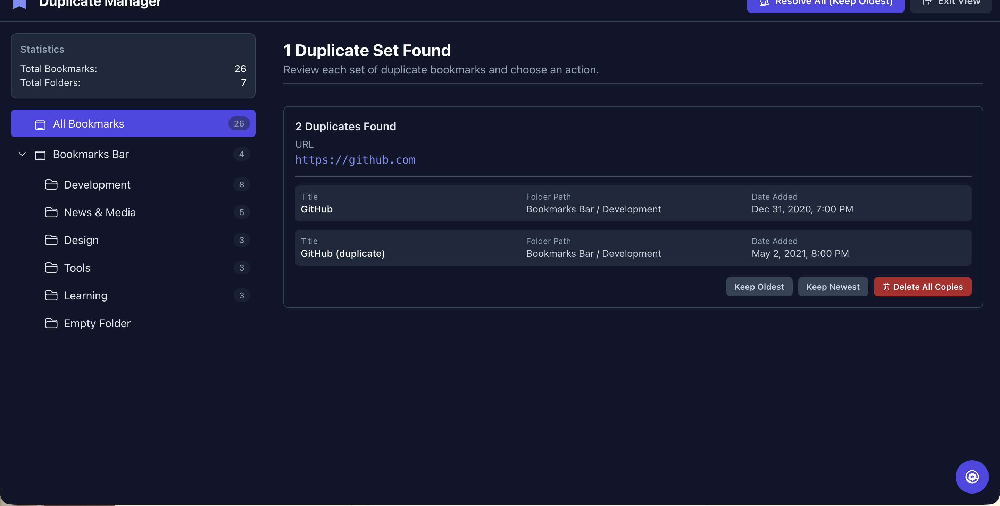
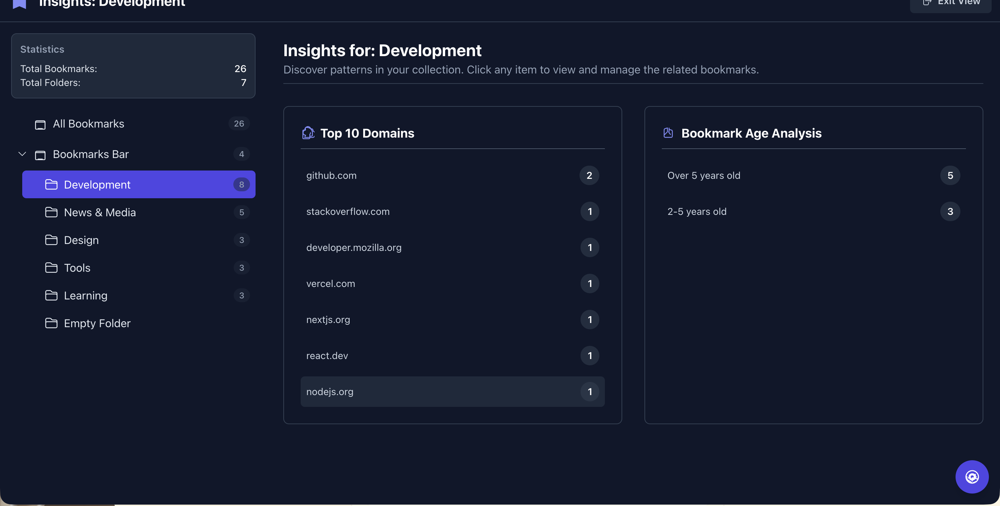

# AI Bookmark Organizer



Drop in a Chrome/Firefox/Safari bookmark export and get instant tools to clean, analyze, and reorganize your collection — with optional AI-powered categorization via Gemini.

## Quick Start

```bash
git clone https://github.com/YOUR_USERNAME/ais-bookmark-organizer.git
cd ais-bookmark-organizer
npm install
npm run dev
```

> Requires Node.js 18+. For AI features, set your Gemini API key in `.env.local`:
> `VITE_GEMINI_API_KEY=your_key_here`

## How It Works

1. **Export bookmarks** from your browser (Chrome → Bookmarks → Bookmark Manager → ⋮ → Export bookmarks)
2. **Upload the HTML file** via the drag-and-drop zone
3. **Browse, clean, and organize** using the sidebar tree and toolbar utilities
4. **Export** the cleaned bookmarks back to HTML and re-import into your browser

The parsing runs in a Web Worker so the UI stays responsive even with thousands of bookmarks.

## Features

### Browse & Navigate
Folder tree in the sidebar mirrors your bookmark hierarchy. Click any folder to see its bookmarks as cards with favicons, URLs, dates, and Wayback Machine links.

### Find Duplicates
Detects bookmarks with identical URLs across your entire collection. Review each set and choose to keep the oldest, newest, or delete all copies.



### Insights & Analytics
See your top domains and bookmark age distribution. Click any domain or age bucket to drill into the matching bookmarks. Works globally or per-folder.



### AI Auto-Categorize
Sends your bookmarks to Gemini in batches and creates a new "AI Categories" folder tree with logically grouped categories (Development, News, Shopping, etc.). Handles rate limiting, retries, and partial failures gracefully.

### Health Audit
Two-stage link checking:
1. **Fast pre-check** — `HEAD` requests catch network errors instantly
2. **AI deep scan** — Gemini analyzes surviving URLs for dead links, redirects, paywalls, parked domains

### Empty Folder Cleanup
Finds and batch-deletes folders with no bookmarks.

### Search
Real-time filtering across bookmark titles and URLs.

### Export
Re-exports your (modified) bookmarks back to standard Netscape Bookmark HTML format, ready to re-import into any browser.

## Tech Stack

| Layer | Technology |
|-------|-----------|
| Framework | React 19 |
| Build | Vite 6 |
| Styling | Tailwind CSS 3 |
| AI | Google Gemini (`@google/genai`) |
| Language | TypeScript |

## License

MIT
